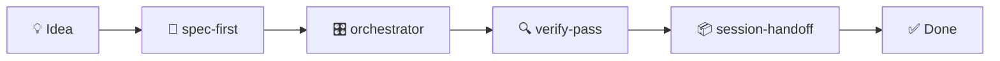
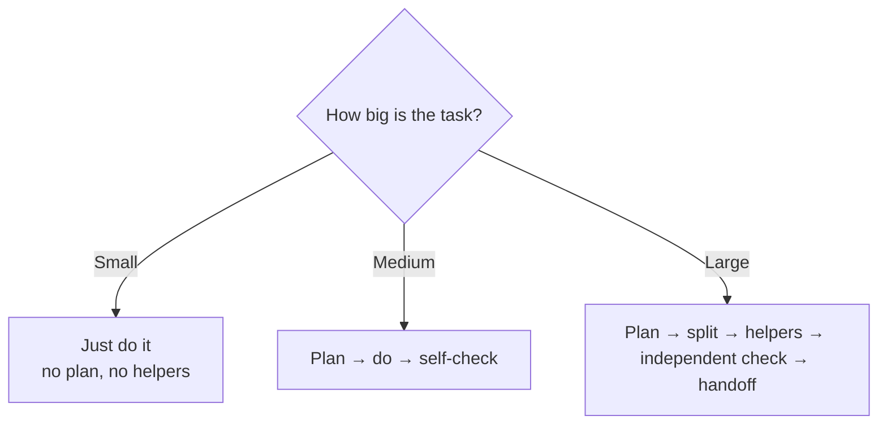
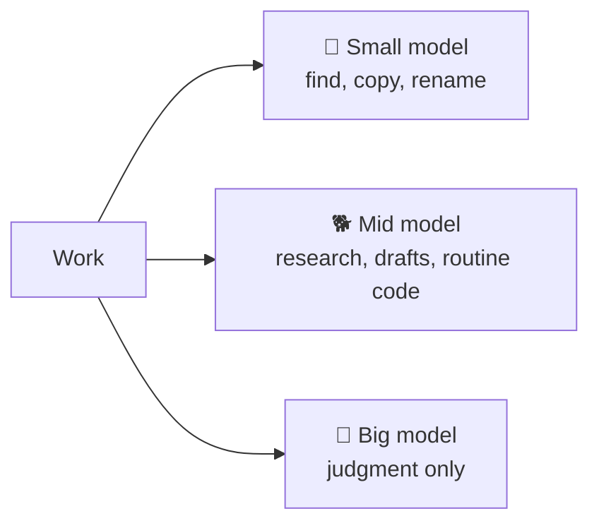
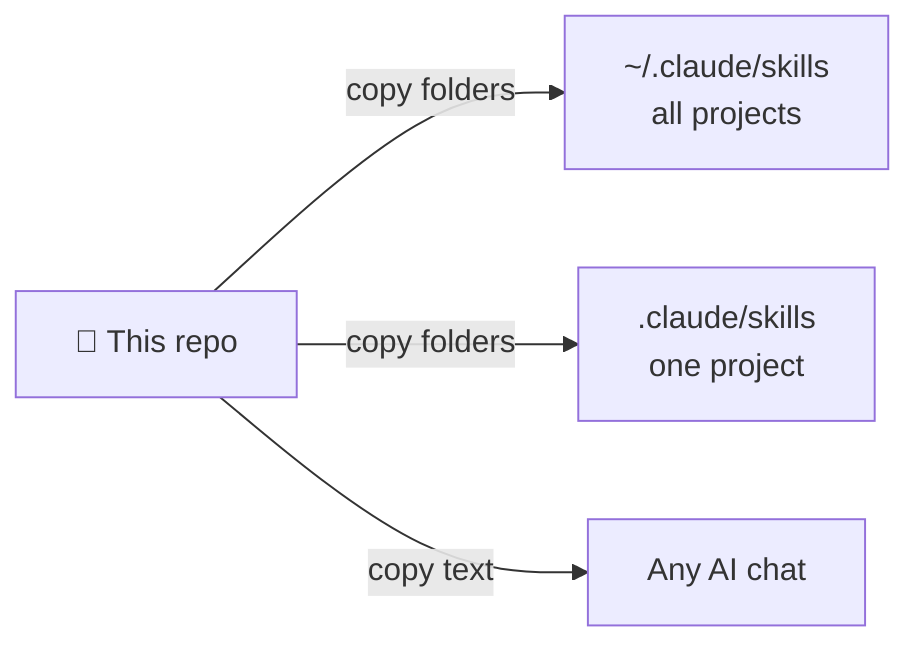

# 🧰 Skill Pack

**15 small instruction files that make Claude work better and cheaper.**

Works in Claude Code, the Claude app, or any AI you can paste text into.

---

## 🤔 What is a skill?

> A skill is a **recipe card** for the AI.
> One folder. One file. Plain text.

```
skills/
└── debug-loop/
    └── SKILL.md   ← the recipe
```

You say `/debug-loop` (or just "it's broken"), and Claude follows the recipe.

---

## 🗺️ The big picture



| Step | Skill | In one line |
|---|---|---|
| 1 | 📝 `spec-first` | Write down what "done" means **before** building |
| 2 | 🎛️ `orchestrator` | Split the work, give each part to the cheapest model |
| 3 | 🔍 `verify-pass` | A second pair of eyes checks everything |
| 4 | 📦 `session-handoff` | Save progress to a file so a new chat can continue |

---

## 🎛️ How the orchestrator saves money





**Rule:** the expensive model only thinks. Cheap models do the legwork.

---

## 📚 All 15 skills

### ⚙️ Process — use on anything

| Skill | Say this | You get |
|---|---|---|
| 🎛️ `orchestrator` | "big task, manage it" | plan + cheap routing + checks |
| 🔍 `verify-pass` | "double check this" | PASS / FAIL table with evidence |
| 📝 `spec-first` | "I want to build…" | one-page spec |
| 📦 `session-handoff` | "wrap up" | `HANDOFF.md` to resume later |
| ✉️ `delegation-brief` | "write a prompt for…" | a prompt that works first try |
| 🐛 `debug-loop` | "it's broken" | cause, fix, proof |
| 🔎 `research-brief` | "find out…" | answer + sources + confidence |
| ⚖️ `decision-memo` | "A or B?" | scored table + verdict |
| 🎓 `learn-mode` | "teach me…" | short lessons with practice |

### 🎨 Design & front-end

| Skill | Say this | You get |
|---|---|---|
| 👁️ `design-critique` | "review this design" | ranked list of fixes |
| 🧩 `design-system-audit` | "audit the tokens" | drift and gaps report |
| 🚀 `frontend-ship-check` | "ready to deploy?" | SHIP / FIX FIRST checklist |

### 💼 Career & portfolio

| Skill | Say this | You get |
|---|---|---|
| 📄 `job-application` | paste a job ad | tailored CV + cover letter (EN/DE) |
| 🖼️ `case-study-writer` | "write up this project" | 60-second case study |
| 🎤 `interview-prep` | "interview with X" | prep sheet + mock round |

---

## 📥 Install

### Claude Code — every project

```bash
git clone https://github.com/Techboidesig/fable-skill-pack.git
mkdir -p ~/.claude/skills
cp -R skill-pack/skills/* ~/.claude/skills/
```

### Claude Code — one project only

```bash
mkdir -p .claude/skills
cp -R path/to/skill-pack/skills/* .claude/skills/
```

Commit `.claude/skills/` and your whole team gets them.

### Claude app or any other AI

Open a `SKILL.md`, copy the text, paste it into the chat or project instructions.



---

## ▶️ Use

Two ways. Both work.

1. **Type the name:** `/verify-pass`
2. **Just ask:** "double check this" — the skill's description triggers it

---


Three rules:

- 📛 Folder name = `name`
- 🎯 `description` says **when** to use it (keep it under 200 characters)
- ✂️ Keep it short — every line costs tokens each time it runs

---

## ❓ FAQ

**Does it need a specific model?** No. Plain instructions. Any model.
**Do I need all 15?** No. Start with `orchestrator` + `verify-pass`.
**Can I edit them?** Yes. They are text files.

---

## 📜 License

MIT — see `LICENSE`.
